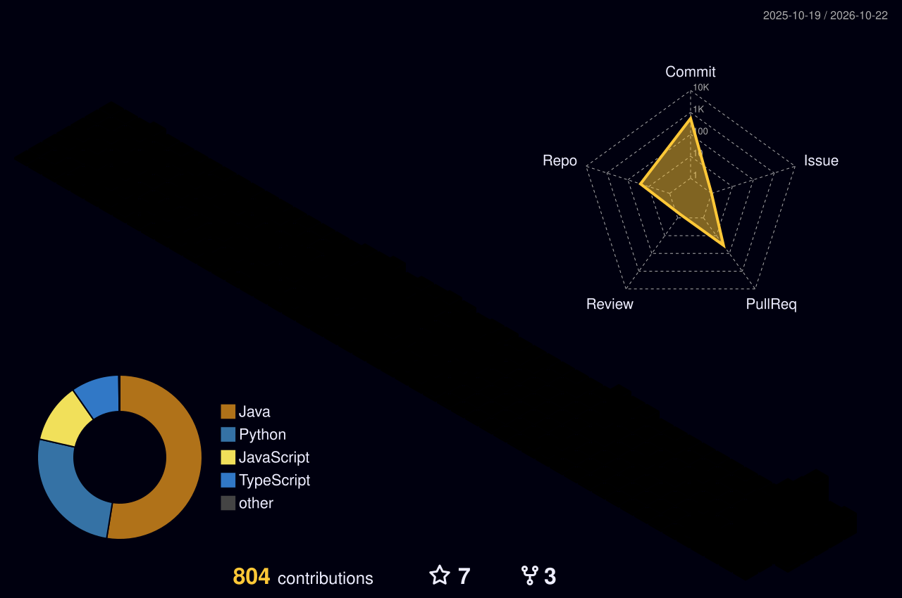

<h1 align="center">Shivansh Garg</h1>
<h3 align="center">Associate Software Engineer @ Lowe's | CS Undergraduate</h3>

  
  

 

<!-- PROFILE-SVG-START -->
<table align="center">
  <tr>
    <td valign="top" align="center">
      
    </td>
    <td valign="top" align="center">
      
    </td>
  </tr>
</table>

  

<!-- PROFILE-SVG-END -->

 

## Quick Summary

- 💼 **Current:** Associate Software Engineer @ **Lowe's**
- 🏢 **Previous:** AI / Full-Stack Engineer @ **Kalvium Labs** *(Architected a unified enterprise productivity platform via Microsoft Graph & Google Workspace APIs)*
- 🎓 **Education:** B.E. Computer Science @ **Chitkara University** *(CGPA: 10.00/10)*
- 🏆 **Top Wins:** Winner @ **Build with Bharat 3.0** | Finalist @ **Hack4Delhi 2026** *(Top 30 / 4,500+ participants)*

 

## Featured Projects

<table bordercolor="#30363d">
  <tr>
    <td width="50%" valign="top">
      <h3 align="center">OpenLearning AI</h3>
      
<i>Intelligent AI-driven educational platform</i>

      

        
      

      

      <ul>
        <li><b>Concept:</b> Transforms any topic or paid course link into a structured, free, and interactive learning curriculum using web and video scraping.</li>
        <li><b>Key Features:</b> Real-time Voice Mentorship (Gemini Live), Context-Aware Neural Tutor, Automated Quizzes, Schedule Builder.</li>
      </ul>
       
      

        
        
        
        
        
        
      

    </td>
    <td width="50%" valign="top">
      <h3 align="center">Notora</h3>
      
<i>Collaborative academic notes platform</i>

      

        
        
      

      

      <ul>
        <li><b>Concept:</b> Centralized platform for university students to upload, search, and download lecture notes with integrated live communications.</li>
        <li><b>Key Features:</b> OCR-based document search, Real-time Socket.io chat. Scaled to <b>100+ active users</b> & <b>1,700+ views</b> rapidly.</li>
      </ul>
       
      

        
        
        
        
        
      

    </td>
  </tr>
</table>

 

## Languages and Tools

   
   
  

 

## 3D Contribution Graph

  

 

## GitHub Analytics

<picture>
  <source media="(prefers-color-scheme: dark)"
    srcset="https://github-readme-stats.vercel.app/api?username=shivanshgarg007&show_icons=true&theme=radical&hide_border=true&bg_color=0d1117&title_color=79c0ff&icon_color=56d364&text_color=c9d1d9" />
  <source media="(prefers-color-scheme: light)"
    srcset="https://github-readme-stats.vercel.app/api?username=shivanshgarg007&show_icons=true&theme=default&hide_border=true&bg_color=ffffff&title_color=0a7ea4&icon_color=2da44e&text_color=24292f" />
  
</picture>
&nbsp;
<picture>
  <source media="(prefers-color-scheme: dark)"
    srcset="https://github-readme-streak-stats.herokuapp.com/?user=shivanshgarg007&theme=radical&hide_border=true&background=0d1117&ring=79c0ff&fire=ffa657&currStreakLabel=79c0ff" />
  <source media="(prefers-color-scheme: light)"
    srcset="https://github-readme-streak-stats.herokuapp.com/?user=shivanshgarg007&theme=default&hide_border=true&background=ffffff&ring=0a7ea4&fire=d73a49&currStreakLabel=0a7ea4" />
  
</picture>

<picture>
  <source media="(prefers-color-scheme: dark)"
    srcset="https://github-readme-stats.vercel.app/api/top-langs?username=shivanshgarg007&layout=compact&theme=radical&hide_border=true&bg_color=0d1117&title_color=79c0ff&text_color=c9d1d9&langs_count=8" />
  <source media="(prefers-color-scheme: light)"
    srcset="https://github-readme-stats.vercel.app/api/top-langs?username=shivanshgarg007&layout=compact&theme=default&hide_border=true&bg_color=ffffff&title_color=0a7ea4&text_color=24292f&langs_count=8" />
  
</picture>

 

## Connect with me

